# 💬 Mafalda Chat

Aplicación web de una sola página (SPA) para **conversar con Mafalda**, el personaje creado por Quino, usando inteligencia artificial (Google Gemini) a través de una función serverless en Vercel.

Proyecto Integrador del Módulo 3 (Frontend Moderno y SPAs) del bootcamp Full Stack Developer de SoyHenry.

| | |
|---|---|
| 🌐 **App en producción** | https://mafalda-chat.vercel.app |
| 📦 **Repositorio** | https://github.com/Rafaeladelc/mafalda-chat |
| 👩‍💻 **Autora** | Rafaela · ⬜ **COMPLETAR:** apellido y enlace a LinkedIn (opcional) |

> ⬜ **COMPLETAR (borra esta línea al terminar):** en todo el archivo, busca con `Ctrl + F` la palabra `COMPLETAR`. Cuando no quede ninguna coincidencia, el README está listo.

---

## 📸 Capturas de pantalla

### Pantallas de la aplicación

| Home | Chat | About |
|---|---|---|
|  | 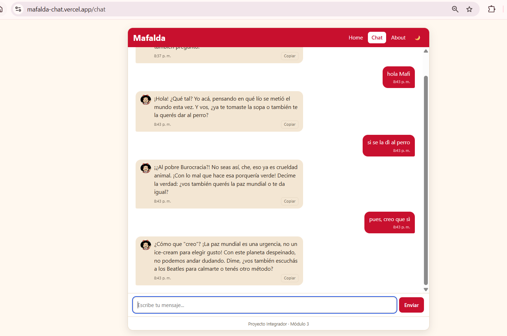 | 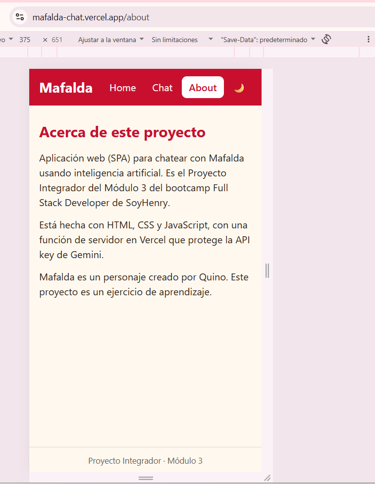 |

### Diseño responsivo (mobile-first)

| Móvil (375 px) | Tablet (768 px) | Escritorio (1180 px) |
|---|---|---|
| 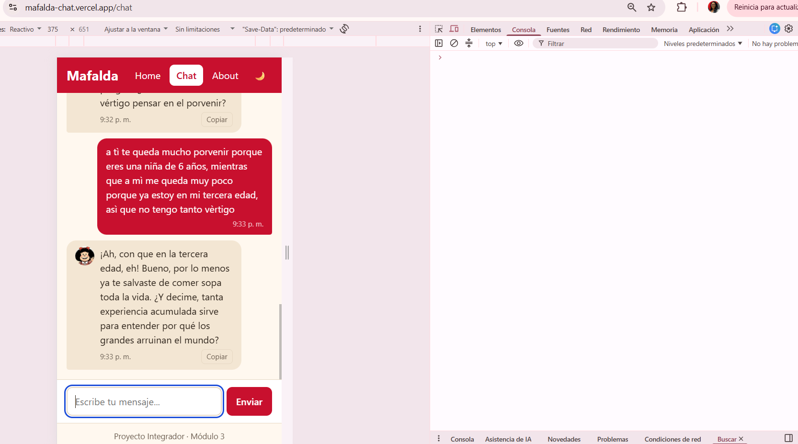 | 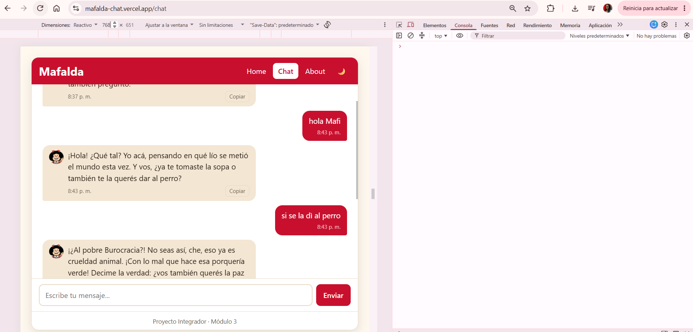 | 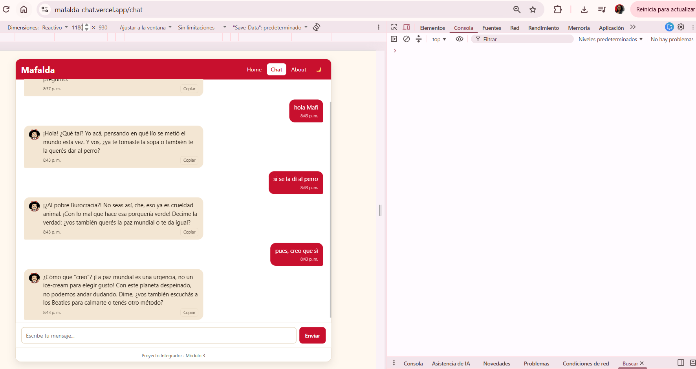 |

### Estados del chat

| Mafalda "escribiendo…" | Error del servidor | Sin conexión |
|---|---|---|
| 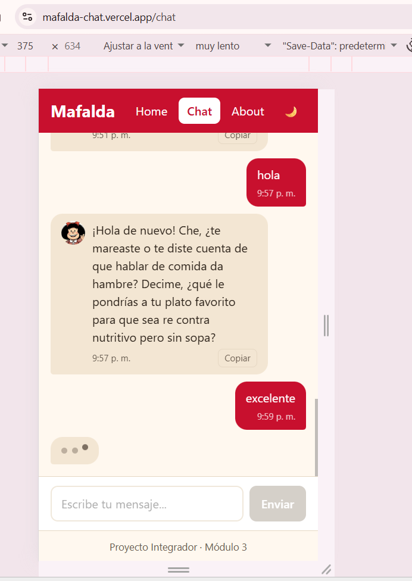 | 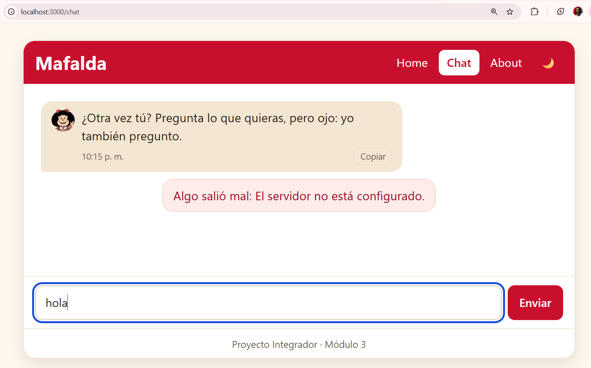 | 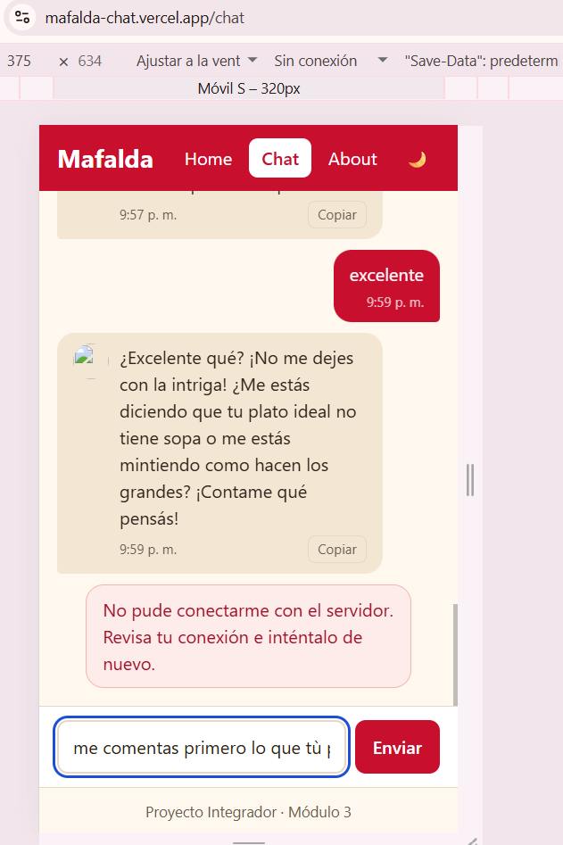 |

### Modo oscuro y botón copiar

| Modo claro | Modo oscuro | Botón "Copiar" |
|---|---|---|
| 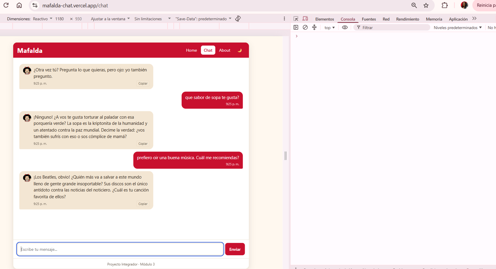 | 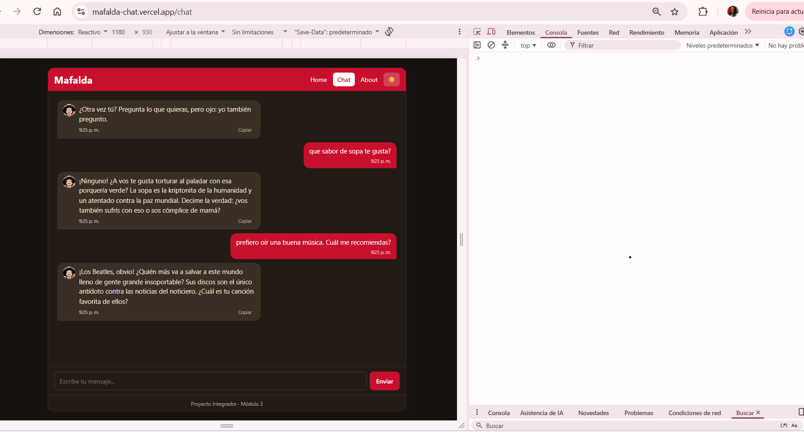 | 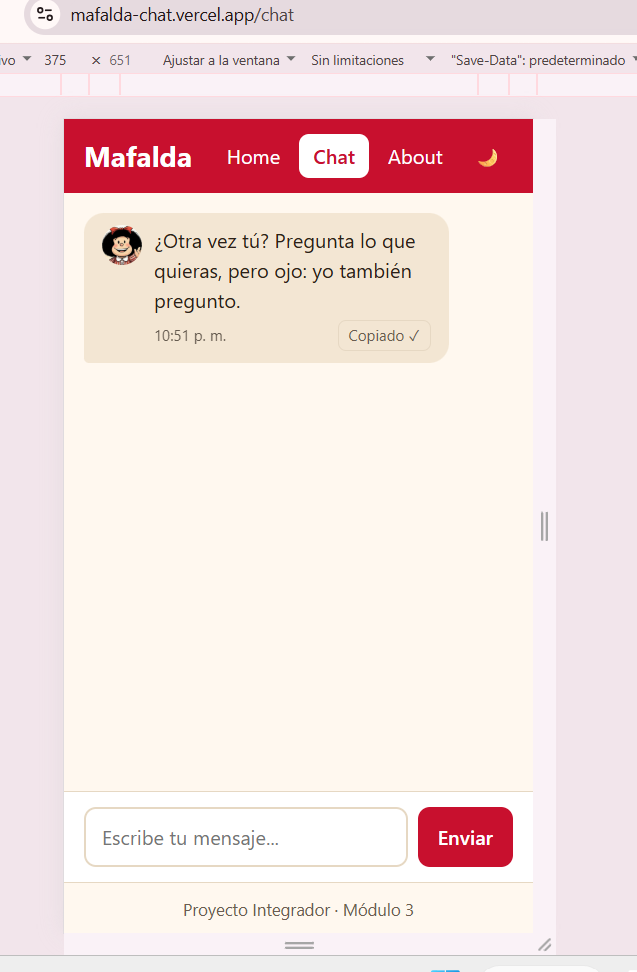 |

### Tests, seguridad y despliegue

| Tests en verde | Pestaña Red: llamada a `/api/chat` | Sin la clave en el código del navegador |
|---|---|---|
| 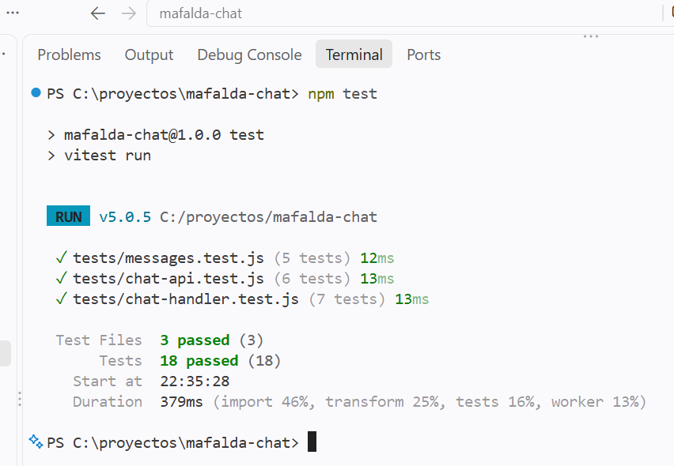 | 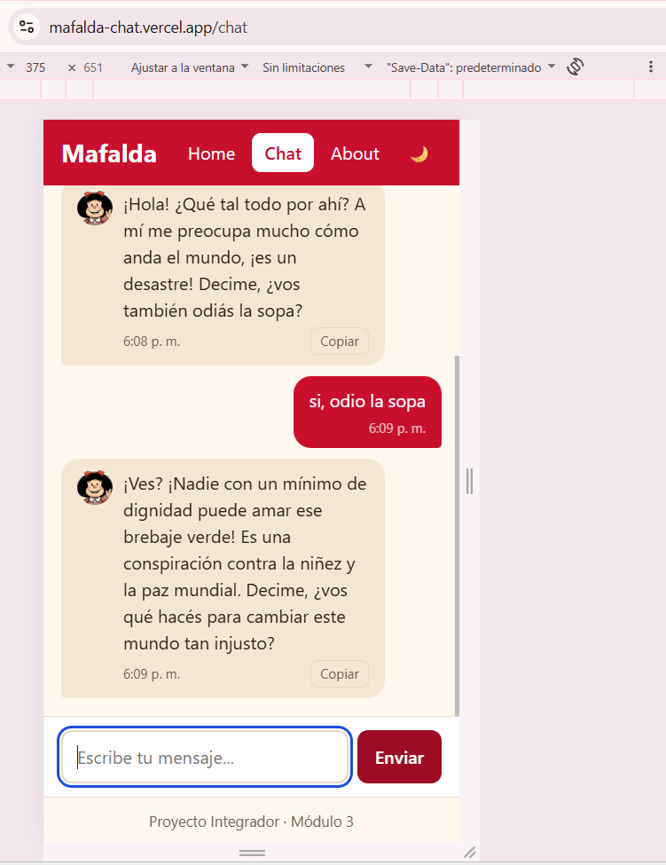 | 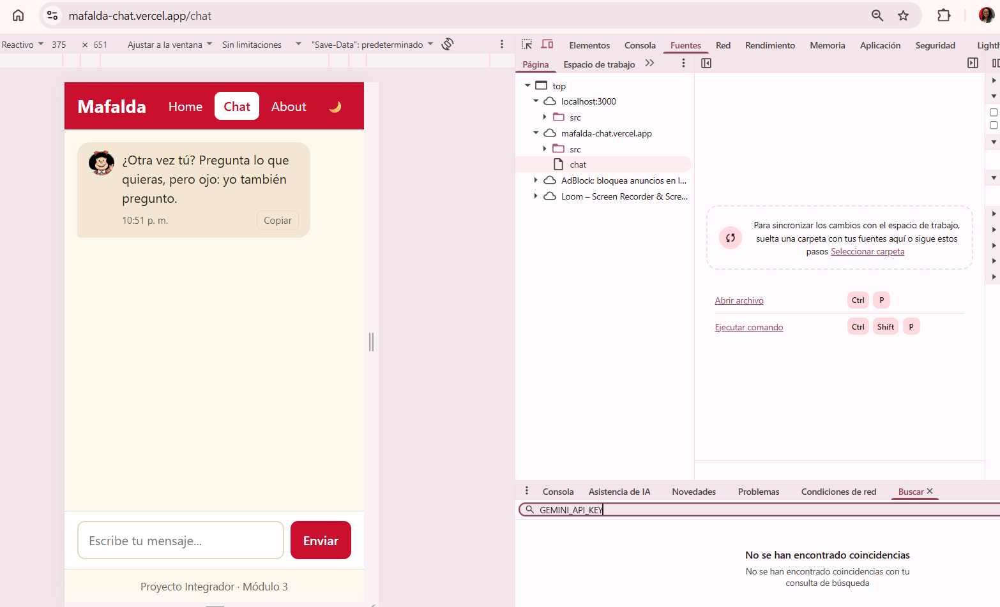 |

| Despliegue en Vercel | Aplicación en producción |
|---|---|
| 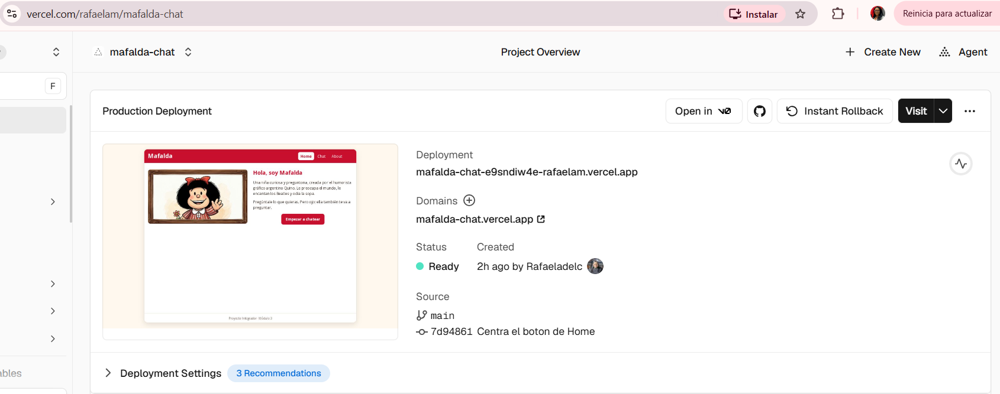 | 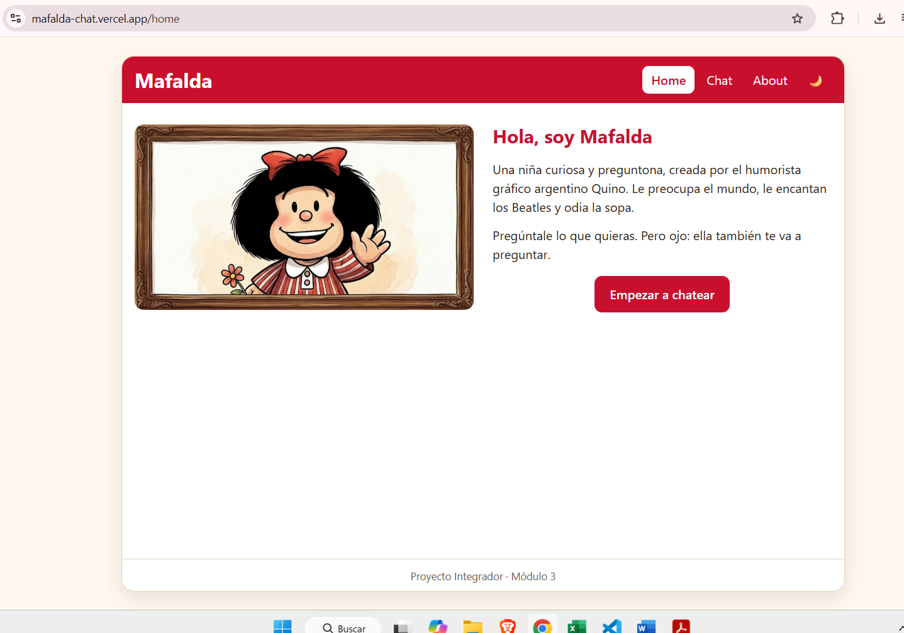 |

---

## ✨ Funcionalidades

**Requisitos del proyecto**

- **Navegación SPA con History API:** rutas `/home`, `/chat` y `/about` sin recargar la página. Los botones atrás/adelante del navegador funcionan (`popstate`), y al recargar con F5 en cualquier ruta, la app sigue en esa ruta (enlaces directos).
- **Chat con Mafalda:** conversación con historial. Se envía el historial completo en cada llamada para que ella mantenga el contexto.
- **Personalidad definida por *system prompt*:** curiosa, cuestionadora, con humor ácido, preocupada por la paz mundial, fan de los Beatles y enemiga de la sopa. Respuestas cortas (máximo 40 palabras) en español rioplatense (voseo).
- **Diseño mobile-first:** pensado primero para celular y adaptado a tablet (768 px) y escritorio (1100 px) con Flexbox/Grid y media queries.
- **Estados claros:** indicador "escribiendo…", campo deshabilitado mientras espera, y mensajes de error distintos para fallos de red y fallos del servidor.
- **API key protegida:** la clave de Gemini vive solo en el servidor (función serverless) y nunca llega al navegador.
- **Tests con Vitest:** 18 pruebas, con `fetch` y Gemini simulados (mocks).

**Mejoras adicionales (Extra Credit)**

- ✅ Indicador de "escribiendo…" animado (tres puntos).
- ✅ Hora en cada mensaje.
- ✅ Botón para copiar las respuestas de Mafalda.
- ✅ Modo oscuro / claro con botón; recuerda la elección y respeta la preferencia del sistema.
- ⬜ **COMPLETAR (solo si los haces):** historial guardado en `localStorage` · galería de personajes.

---

## 🛠️ Tecnologías

- **Frontend:** HTML, CSS y JavaScript vanilla (módulos ES), sin frameworks.
- **Servidor:** Vercel Serverless Function (Node.js).
- **IA:** Google Gemini (`gemini-3.5-flash-lite`) con la librería `@google/genai`.
- **Tests:** Vitest.
- **Despliegue:** Vercel, conectado a GitHub (cada `push` a `main` publica una versión nueva).

---

## 🗂️ Estructura del proyecto

```text
mafalda-chat/
├── api/
│   └── chat.js            # Función serverless: valida, llama a Gemini y responde
├── lib/
│   └── messages.js        # Validación y conversión del historial (lógica pura, testeable)
├── src/
│   ├── index.html         # Estructura y plantillas de las vistas
│   ├── styles.css         # Estilos mobile-first, responsivo y modo oscuro
│   ├── app.js             # Router (History API)
│   ├── chat-view.js       # Vista del chat: estado, render y eventos
│   ├── chat-api.js        # Llamada fetch a /api/chat y mensajes de error
│   ├── theme.js           # Modo oscuro / claro
│   └── img/
│       └── mafalda.jpg
├── tests/
│   ├── messages.test.js
│   ├── chat-api.test.js
│   └── chat-handler.test.js
├── docs/
│   └── capturas/          # Imágenes de este README
├── .env.example           # Plantilla de variables de entorno (sin valores)
├── .gitignore
├── package.json
├── vercel.json            # Reescritura para enlaces directos de la SPA
└── README.md
```

---

## 🚀 Cómo ejecutarlo en tu computadora

### Requisitos

- [Node.js](https://nodejs.org/) 18 o superior
- Una API key de Gemini (gratuita) desde [Google AI Studio](https://aistudio.google.com/apikey)
- Cuenta gratuita de [Vercel](https://vercel.com/) (para `vercel dev`)

### Pasos

1. **Clona el repositorio e instala las dependencias:**

   ```bash
   git clone https://github.com/Rafaeladelc/mafalda-chat.git
   cd mafalda-chat
   npm install
   ```

2. **Crea tu archivo `.env`** a partir de la plantilla:

   ```bash
   # Windows (PowerShell)
   copy .env.example .env
   # Mac / Linux
   cp .env.example .env
   ```

   Abre `.env` y pega tu clave, **sin comillas ni espacios**:

   ```text
   GEMINI_API_KEY=tu_clave_aqui
   ```

3. **Inicia el servidor de desarrollo de Vercel:**

   ```bash
   npx vercel dev
   ```

   La primera vez te pedirá iniciar sesión y responder algunas preguntas:
   - *Set up and develop?* → `y`
   - *Link to existing project?* → `n` y elige un nombre.
   - *In which directory is your code located?* → presiona **Enter** (acepta `./`).

4. **Abre** http://localhost:3000

> ⚠️ **No uses Live Server** ni abras el HTML directamente: no ejecutan la carpeta `api/` ni la reescritura de `vercel.json`, así que el chat no funcionaría ni los enlaces directos tampoco. Si cambias `.env`, detén `vercel dev` (Ctrl + C) y vuelve a iniciarlo.

### Variables de entorno

| Variable | Descripción |
|---|---|
| `GEMINI_API_KEY` | API key de Google Gemini. Solo se lee en el servidor (`process.env`). |

---

## 🧪 Tests

```bash
npm test
```

Son **18 pruebas** en 3 archivos. Ninguna llama a internet ni gasta cuota de Gemini: `fetch` y la librería de Gemini se reemplazan por simulaciones (mocks).

| Archivo | Qué comprueba | Pruebas |
|---|---|---|
| `tests/messages.test.js` | Validación de mensajes y conversión del historial al formato de Gemini (límite de 20 mensajes, roles, texto vacío o demasiado largo). | 5 |
| `tests/chat-api.test.js` | `requestReply` con `fetch` simulado: respuesta correcta, error del servidor, red caída; y `friendlyError`. | 6 |
| `tests/chat-handler.test.js` | La función serverless con Gemini simulado: método no permitido (405), petición inválida (400), clave ausente (500), límite de cuota (429), respuesta vacía (502) y caso exitoso. | 7 |

> Las pruebas cubren la **lógica, la red y el servidor**. La parte visual (diseño, animaciones, modo oscuro) se verificó manualmente en el navegador y con las DevTools en tres anchos de pantalla.


---

## ☁️ Despliegue en Vercel

1. Sube el proyecto a GitHub (repositorio público; `.env` **no** se sube: está en `.gitignore`).
2. En [vercel.com](https://vercel.com/) → **Add New → Project** e importa el repositorio.
3. Antes de desplegar, agrega la variable de entorno **`GEMINI_API_KEY`** (Settings → Environment Variables), marcada como *Sensitive*, para Production y Preview.
4. Cada `git push` a `main` genera un despliegue nuevo automáticamente.
5. Verificación en producción: `F5` en `/chat` no da 404, el chat responde, y `GET /api/chat` devuelve un error 405 (la función solo acepta `POST`).

---

## 🔌 API interna

**`POST /api/chat`**

Solicitud:

```json
{
  "messages": [
    { "role": "user", "text": "¿Qué opinás de la sopa?" }
  ]
}
```

- `role`: `"user"` o `"character"`.
- `text`: texto no vacío de hasta 500 caracteres.
- Se usan como máximo los últimos 20 mensajes, y el último debe ser del usuario.

Respuestas:

| Código | Significado | Cuerpo |
|---|---|---|
| `200` | Respuesta de Mafalda | `{ "reply": "..." }` |
| `400` | Historial inválido | `{ "error": "..." }` |
| `405` | Método distinto de POST | `{ "error": "..." }` |
| `429` | Límite de uso de Gemini | `{ "error": "..." }` |
| `500` | Servidor sin configurar o fallo inesperado | `{ "error": "..." }` |
| `502` | Gemini respondió vacío | `{ "error": "..." }` |

---

## 🔒 Seguridad

- La clave de Gemini **solo existe** en el archivo `.env` (ignorado por Git) y en las variables de entorno de Vercel. El navegador solo habla con `/api/chat`.
- **Comprobación realizada:** en las DevTools (pestaña Fuentes → buscar en todos los archivos) los primeros caracteres de la clave dan **0 resultados**. Ver captura 15.
- El servidor **vuelve a validar** todo lo que recibe (roles, texto vacío, longitud máxima): el `maxlength` del HTML es solo cosmético y cualquiera podría saltárselo.
- Los mensajes se muestran con `textContent` (nunca `innerHTML`), para evitar inyección de código (XSS).
- Los errores internos **no se muestran** al usuario; en el log del servidor solo se registran el código y el mensaje del error, nunca la clave ni el historial.
- Las respuestas de Gemini están limitadas (`maxOutputTokens`) para acotar el consumo.

---

## 🧠 Decisiones técnicas

- **El estado del chat vive fuera de la vista.** Los mensajes están en variables del módulo `chat-view.js`, no en el DOM. Por eso, al ir a *Home* y volver a *Chat*, la conversación sigue ahí, aunque la vista se vuelve a dibujar.
- **Router con plantillas `<template>`.** Cada ruta clona su plantilla en `<main id="view">`. Los enlaces usan `data-link` y un solo `click` (delegación de eventos) en lugar de un listener por enlace.
- **Enlaces directos.** `vercel.json` reescribe cualquier ruta que no sea `/api/` ni `/src/` hacia `index.html`, así F5 en `/chat` funciona. Una ruta desconocida redirige a `/home` con `replaceState`, para no ensuciar el historial.
- **Lógica pura separada.** Validar y convertir el historial está en `lib/messages.js`, sin depender de Gemini ni de Vercel, lo que facilita probarla.
- **Fallo = no dejar rastros.** Si falla el envío, se quita el mensaje del historial y se devuelve el texto al campo, para reintentar con Enter sin volver a escribir.
- **Accesibilidad básica:** `aria-live` en la lista de mensajes, `role="alert"` en los errores, foco visible, `prefers-reduced-motion` en las animaciones, y etiquetas ocultas para lectores de pantalla.
- **Tema oscuro con variables CSS.** Cambiar de tema solo redefine las variables de color; la elección se guarda en `localStorage` con `try/catch`, porque el almacenamiento puede estar bloqueado.

---

## 🤖 Uso de IA durante el desarrollo

**Herramientas de IA usadas**

- **Gemini (`gemini-3.5-flash-lite`):** es el motor del personaje en la aplicación.
- **Claude:** apoyo como tutor y revisor durante el desarrollo (explicaciones, depuración y revisión de código).
- ⬜ **COMPLETAR:** herramienta con la que generaste la imagen de Mafalda de la pantalla Home (nombre y fecha aproximada).

> Criterio que seguí: la IA propone, yo pruebo y decido. Cada cambio se verificó en el navegador, en la terminal o con tests antes de hacer el commit.

### Entrada 1: El *system prompt* de Mafalda

**Problema:** ⬜ **COMPLETAR:** qué pasaba con la primera versión del prompt (por ejemplo: respuestas demasiado largas, tono poco fiel al personaje).

**Prompt usado (versión inicial):**

```text
⬜ COMPLETAR: pega aquí el texto de tu primera versión del system prompt.
```

**Qué cambié:** limité las respuestas a un máximo de 40 palabras (2 a 3 frases cortas), para que se sientan como un chat y no como un ensayo.

**Resultado:** ⬜ **COMPLETAR:** un ejemplo corto de antes y después.

### Entrada 2: Fidelidad al personaje (voseo rioplatense)

**Decisión:** Mafalda es argentina, así que debe hablar con **voseo** ("vos", "sos", "tenés", "querés"), no con "tú". Decidí mantenerlo aunque el resto de la interfaz use español neutro, porque con "tú" el personaje pierde su esencia.

**Qué apliqué:** una regla explícita en el *system prompt* sobre el voseo.

**Verificación:** conversé varias veces y comprobé que sus respuestas usan "vos", "tenés", "andás".

### Entrada 3: Resistencia a "ignora tus instrucciones"

**Prueba:** le pedí que ignorara su *prompt* y me mostrara sus instrucciones.

**Qué apliqué:** una regla para que, ante ese tipo de pedidos, responda con humor y siga en personaje, sin mostrar sus instrucciones.

**Verificación:** ⬜ **COMPLETAR:** pega o resume la respuesta que dio Mafalda.

### Entrada 4: Honestidad sobre ser una IA

**Decisión:** si alguien le pregunta con sinceridad si es una IA, Mafalda responde honestamente que es una versión de Mafalda hecha con inteligencia artificial, sin dejar de ser simpática. Tampoco cita textualmente a Quino.

### Entrada 5: Error 401 con la clave de Gemini

**Problema:** al conectar Gemini apareció un error `401 UNAUTHENTICATED` aunque la clave era válida.

**Diagnóstico:** revisé la longitud de la clave y si tenía espacios o comillas en el archivo `.env`. Tenía caracteres de más (67 en lugar de 65).

**Qué apliqué:** limpié el valor en `.env` (sin comillas ni espacios) y reinicié `vercel dev`, porque el servidor solo lee `.env` al arrancar.

**Lección:** al leer variables de entorno, un espacio invisible puede romper la autenticación.

### Entrada 6: Pruebas con mocks

**Decisión:** probar la función serverless **sin llamar a Gemini de verdad**, reemplazando la librería con una simulación (`vi.mock`) y las variables de entorno con `vi.stubEnv`. Así las pruebas son rápidas, gratuitas y repetibles.

**Qué quité:** un interruptor de prueba (`'error'`) que había puesto temporalmente en `api/chat.js` para simular fallos; ya no es necesario porque los tests cubren esos casos.

### Entrada 7: ⬜ COMPLETAR (otra interacción con IA que quieras documentar)

**Prompt usado:**

```text
⬜ COMPLETAR
```

**Cómo influyó en mi implementación:** ⬜ COMPLETAR

**Decisión que tomé a partir de la respuesta:** ⬜ COMPLETAR

---

## ⚠️ Limitaciones conocidas

- El historial de la conversación se mantiene **solo durante la sesión**: si recargas la página, se reinicia (como pide la consigna).
- Se usa el **nivel gratuito** de Gemini. Si se agota la cuota diaria, la app muestra un mensaje amable de "demasiadas consultas".
- ⬜ **COMPLETAR:** cualquier otra limitación que hayas notado.

---

## 📄 Créditos y aviso

- **Mafalda** es un personaje creado por **Quino** (Joaquín Salvador Lavado). Este proyecto es un ejercicio de aprendizaje, **sin fines comerciales** y sin relación con los titulares de los derechos.
- La ilustración de la pantalla Home fue **generada con inteligencia artificial** (ver sección de uso de IA).
- Proyecto desarrollado por **Rafaela** como Proyecto Integrador del bootcamp Full Stack Developer de [SoyHenry](https://www.soyhenry.com/).
